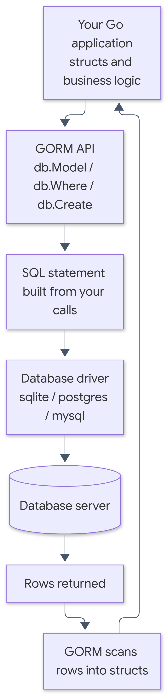

# Cookbook Template

A copy-paste template for writing and publishing technical e-books as **EPUB** and **PDF** from Markdown chapter files. It pairs a plain-Markdown manuscript with a Rust build tool ([cookbook_generator](https://github.com/anoochit/cookbook_generator)) and a set of AI-agent skills, so a book can be drafted, reviewed, and built without leaving the editor.

This repository ships as a working example — the current manuscript is the book *GORM: ORM in Go for beginners* — but every part of it is meant to be replaced with your own content.

## Prerequisites

The build tool shells out to several programs, so all of these must be installed and on your `PATH`:

| Tool | Why it is needed |
| --- | --- |
| [Rust](https://www.rust-lang.org/tools/install) | Builds `cookbook_generator` itself |
| [Pandoc](https://pandoc.org/installing.html) | Converts Markdown to EPUB and to PDF input |
| [Calibre](https://calibre-ebook.com/download) (`ebook-convert`) | EPUB assembly and EPUB → PDF conversion |
| [pdfcpu](https://pdfcpu.io/install) | PDF post-processing (stamping, page merging) |
| [Node.js](https://nodejs.org/) + `@mermaid-js/mermaid-cli` | Renders Mermaid diagrams to PNG |
| [Zig](https://ziglang.org/download/) | Only if cross-compiling the generator for other platforms |

Install the diagram tooling globally:

```bash
npm install -g @mermaid-js/mermaid-cli
```

Install the generator, either as a prebuilt release or from source:

```bash
git clone https://github.com/anoochit/cookbook_generator
cd cookbook_generator
cargo build --release
```

Put the resulting executable on your `PATH` as `cookbook_generator`.

## Quick start

Write your chapters, then build:

```bash
make gen
```

or call the tool directly:

```bash
cookbook_generator build
```

Output is written to `build/`. The first build will prompt for the front- and back-matter page numbers; pass `--skip-prompts` once you know the values:

```bash
cookbook_generator build --skip-prompts
```

`cookbook_generator init` writes a fresh `config.txt` if you are starting from scratch.

> The `Makefile` hardcodes `pwsh.exe` (PowerShell) as its shell, so `make gen` is Windows-oriented. On macOS or Linux, call `cookbook_generator build` directly.

## Repository layout

```text
.
├── toc.md                      # Table of contents + per-chapter source citations
├── config.txt                  # PDF layout: fonts, page size, margins
├── epub.yaml                   # Book metadata: title, subtitle, author, language
├── epub.css                    # EPUB stylesheet
├── calibre_extra_css.css       # Extra CSS for the PDF table of contents
├── Makefile                    # `make gen` builds the book; `make commit-ai` assists commits
├── chapters/                   # Markdown chapter sources, one file per chapter
│   ├── 00_preface.md
│   ├── 01_introduction.md
│   └── ...
├── images/                     # Covers, figures, and diagram sources
│   ├── figX-Y.mmd              # Mermaid source for figure X.Y
│   ├── figX-Y.png              # Rendered figure X.Y, referenced by chapters
│   ├── cover.pdf / cover.png   # Front cover
│   └── back_cover.pdf/.png     # Back cover
├── .agents/skills/             # AI-agent skills for writing and diagramming
├── fonts/                      # Bundled Bai Jamjuree family (+ OFL license)
└── build/                      # Generated output (gitignored)
```

`build/` is ignored by Git. Do not commit generated EPUB/PDF files.

## Writing a book

### Chapters

Chapters are plain Markdown files in `chapters/`, named `NN_snake_case.md` and ordered by the numeric prefix. Each chapter opens with a level-1 heading:

```markdown
# Chapter 1: Introduction

A two-to-four sentence lead paragraph that sets up the problem and the
chapter's goal, written before the first ## heading.

## What is an ORM

Section content...

## Summary

Closing prose.
```

The enforced conventions — a lead paragraph under the title, no `---` dividers, no topic numbers in headings, no citation lines, and a prose `## Summary` — are documented in [`AGENTS.md`](AGENTS.md). Read that file before writing; it is what the agent skills check against.

### Table of contents and citations

`toc.md` is the single source of truth for the book's structure. It lists each chapter's file path, purpose, planned sections, and the external documents the chapter is based on.

Citations live **only** in `toc.md`, never inside chapter files. Keep it in sync when you add or rename a chapter.

### Figures

Chapters reference **pre-rendered PNG images**; do not paste live ` ```mermaid ` blocks into chapter files. The `mermaid-figures` skill owns this workflow:

1. Write the diagram in `images/figX-Y.mmd`, where `X` is the chapter and `Y` the figure sequence within it.
2. Reference it from the chapter with descriptive alt text and an explanatory paragraph:

   ```markdown
   

   A paragraph explaining what the diagram shows...
   ```

3. Render and check:

   ```bash
   node .agents/skills/mermaid-figures/scripts/render-mermaid.js --chapter 1 --jobs 4
   node .agents/skills/mermaid-figures/scripts/verify-figures.js
   ```

   Drop `--chapter` to re-render every figure. `verify-figures.js` confirms that every image reference has matching `.mmd` and `.png` files, descriptive alt text, and an explanatory paragraph beneath it.

Prefer vertical `flowchart TD` diagrams over wide `sequenceDiagram` blocks — horizontal diagrams shrink past readability on e-reader screens.

## Configuration

### `config.txt` — PDF layout

Controls the PDF build: font families, base font sizes, page margins, and paper size.

```ini
pdf_sans_family = Bai Jamjuree
pdf_mono_family = DejaVu Sans
pdf_default_font_size = 22
pdf_mono_font_size = 16
paper_size = a4
pdf_toc_title=สารบัญ
```

`pdf_toc_title` is the heading shown above the generated PDF table of contents — set it to match your book's language.

### `epub.yaml` — metadata

The book's title, subtitle, author, and language. This is what appears on the cover page and in the EPUB's Dublin Core metadata:

```yaml
title:
  - type: main
    text: "GORM"
  - type: subtitle
    text: "ORM in Go for beginners"
author: "Your Name"
language: "en-US"
```

### Stylesheets

- `epub.css` — the main book stylesheet: body text, headings, code blocks, tables, and links. Adjust `font-family` and `font-size` here to rebrand the book.
- `calibre_extra_css.css` — styling applied only to the PDF's generated table-of-contents table.

### Fonts

The `fonts/` directory bundles the [Bai Jamjuree](https://fonts.google.com/specimen/Bai+Jamjuree) family under the SIL Open Font License (see `fonts/OFL.txt`). It covers both Latin and Thai glyphs. To use different typefaces, drop the TTFs in here and update `config.txt` and `epub.css` to match.

## AI-agent skills

`.agents/skills/` contains skills picked up by AI coding agents working in this repository:

- **`technical-book-writer`** — writing and editing rules: information architecture, terminology consistency, code-example standards, production mindset, and a final QA checklist.
- **`mermaid-figures`** — the diagram workflow described above, plus the render, extract, and verify scripts.

`AGENTS.md` at the repository root is the companion instructions file; it records the project's formatting rules and build commands so agents stay consistent with the house style.

## Output

`cookbook_generator build` produces, among other intermediates:

| File | Format |
| --- | --- |
| `build/ebook_epub3.epub` | EPUB 3 e-book |
| `build/output.pdf` | PDF |

Sample and intermediate files (`sample_*`, `*_input.md`, split page ranges) also land in `build/`. They are gitignored and safe to delete between builds.

## License

This template is released under the terms in [`LICENSE`](LICENSE). The bundled Bai Jamjuree fonts are licensed separately under the SIL Open Font License — see `fonts/OFL.txt`.
